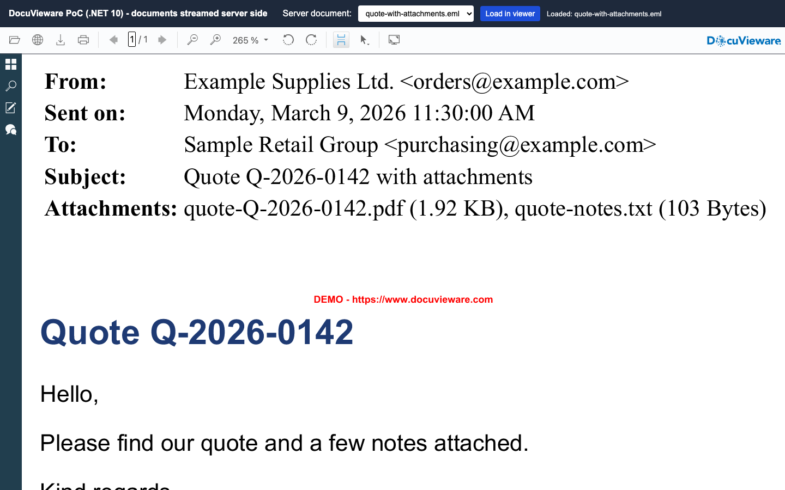
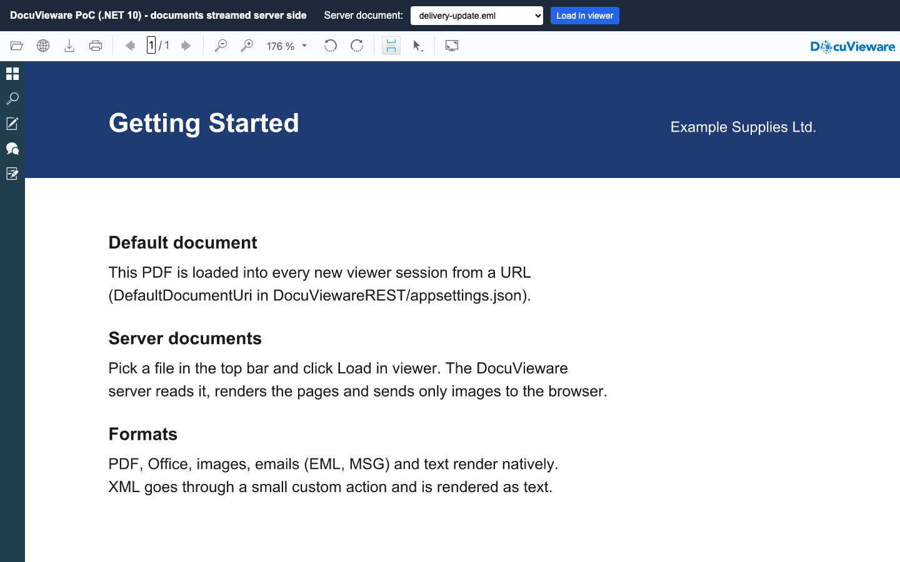
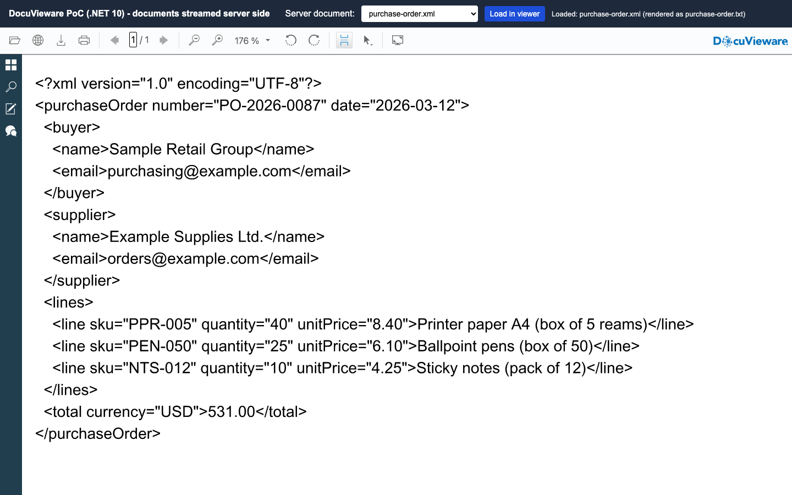

# Nutrient DocuVieware on .NET 10

A Nutrient.io demo that runs DocuVieware on ASP.NET Core and .NET 10 as a REST backend with an MVC frontend, and streams server documents (PDF, Office, images, emails, XML) into the viewer without sending the files to the browser.



*Screenshots are taken in evaluation mode, so DocuVieware shows a demo mark on the pages.*

1. **Backend.** `DocuViewareREST` hosts the DocuVieware control (`DocuVieware.API` package, cross-platform). It creates viewer sessions, renders pages and answers the control's own requests on `api/docuvieware3/*`.
2. **Frontend.** `MvcFrontend` stands in for your application. On each page load it calls `POST /api/DocuViewareREST/GetDocuViewareControl` from the server side, gets the control HTML and puts it into a Razor view.
3. **Default document.** A new session loads `DefaultDocumentUri` (a PDF in the backend's `wwwroot`) with `LoadFromUri`, so the viewer never starts empty.
4. **Server documents.** The top bar lists the files of `DocuViewareREST/App_Data/Documents`. When you load one, the DocuVieware server fetches it from `GET /api/DocuViewareREST/GetDocument/{name}`, renders it and sends only page images to the browser.
5. **XML.** XML is not a viewer format. A custom action (`loadServerFile`) loads the file under a `.txt` name, so it renders as text.

## Prerequisites

- .NET SDK 10
- Windows, macOS or Linux (DocuVieware.API is cross-platform)
- Internet access: the page loads jQuery from the Google CDN

## Environment variables

All variables are optional. Start from `.env.example`. The license key is only read from the environment, never from code. The other values can also be set in `appsettings.json`.

| Variable | Purpose | Default |
|---|---|---|
| `DOCUVIEWARE_LICENSE_KEY` | DocuVieware license key used by the backend | empty = evaluation mode |
| `AppUri` | Public base URL of the backend, embedded in the control markup | `http://localhost:65088` |
| `DefaultDocumentUri` | Document loaded into every new session | `http://localhost:65088/getting-started.pdf` |
| `BackendBaseUrl` | Backend URL used by the frontend | `http://localhost:65088` |
| `FrontendUrl` | Address of the frontend | `http://localhost:8090` |

`AppUri` ends up in the HTML of the control, so the browser must be able to reach it. Keep `localhost` when you browse on the same machine. Use the server's host name or IP address when users connect from elsewhere, and set `BackendBaseUrl` to the same value.

In evaluation mode DocuVieware shows a demo mark on the pages, and the backend process stops after one hour. Start it again, or set a trial or commercial key to remove both limits.

## Build and run

Start the backend on <http://localhost:65088>:

```bash
cp .env.example .env
```

```bash
cd DocuViewareREST
```

```bash
set -a && source ../.env && set +a && dotnet run
```

In a second terminal, start the frontend on <http://localhost:8090>:

```bash
cd MvcFrontend
```

```bash
set -a && source ../.env && set +a && dotnet run
```

Open <http://localhost:8090>.

## Using the app

1. The viewer opens with the default document.

   

2. Pick a file in **Server document** and click **Load in viewer**. The status on the right shows the result.
3. Load `quote-with-attachments.eml`: the email renders with its header block and HTML body.
4. Load `purchase-order.xml`: the status reads "rendered as purchase-order.txt" and the XML shows as text.

   

5. Drop your own files into `DocuViewareREST/App_Data/Documents`. They appear in the list after a page reload.

Every page load starts a new DocuVieware session. Sessions expire after 20 minutes of inactivity and are stored in `DocuViewareREST/Cache`.

## Sample documents

`DocuViewareREST/App_Data/Documents` holds six fictitious English samples: a service agreement PDF, a purchase order in XML, two emails (one with attachments), a spreadsheet and a receipt image. `DocuViewareREST/wwwroot/getting-started.pdf` is the default document. Names and amounts are invented and email addresses use `example.com`. They are generated by `samples/generate_samples.py`:

```bash
python3 -m venv .venv-samples
```

```bash
.venv-samples/bin/pip install reportlab openpyxl pillow pypdf
```

```bash
.venv-samples/bin/python samples/generate_samples.py
```

## API

Backend routes (`DocuViewareREST`):

| Method and path | Description |
|---|---|
| `POST /api/DocuViewareREST/GetDocuViewareControl` | Body: session ID, control ID and toolbar options. Returns `{ htmlContent }`, the control markup. New sessions load the default document |
| `GET /api/DocuViewareREST/GetDocumentsList` | File names in `App_Data/Documents` |
| `GET /api/DocuViewareREST/GetDocument/{name}` | One document, fetched by the DocuVieware server through `LoadFromUri` |
| `api/docuvieware3/*` | Internal routes of the DocuVieware control |

Custom action, called from the page with `DocuViewareAPI.PostCustomServerAction`:

| Action | Argument | Result |
|---|---|---|
| `loadServerFile` | File name in `App_Data/Documents` | Loads the file into the session; XML is loaded as `.txt`. Returns `OK:<name>` or `ERROR: ...` |

## Project layout

| Path | Content |
|---|---|
| `DocuViewareREST/Program.cs` | Backend setup, license, DocuVieware configuration and the `loadServerFile` custom action |
| `DocuViewareREST/Controllers/DocuViewareRESTController.cs` | Control markup, document list and document stream |
| `DocuViewareREST/Controllers/DocuVieware3Controller.cs` | DocuVieware control routes |
| `MvcFrontend/Controllers/HomeController.cs` | Calls the backend and passes the control HTML to the view |
| `MvcFrontend/Views/Home/Index.cshtml` | Page with the document picker |
| `samples/generate_samples.py` | Sample generator |
